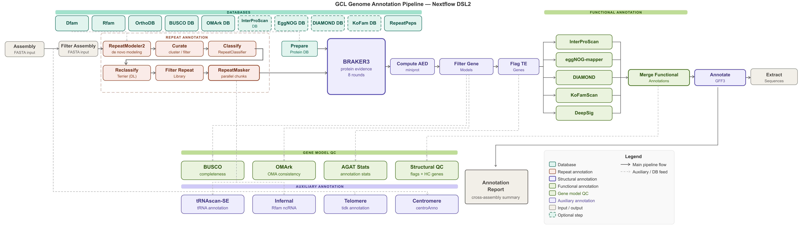

# gcl_genome_annotation
Pipeline for Genome Annotation

## Pipeline rework

The new [input and taxonomy preflight](docs/foundation-preflight.md) supports two-sheet validation, global defaults, per-assembly overrides and taxonomy-derived settings. The integrated `main.nf` now connects preparation, repeats, alignment and BRAKER3 prediction. Downstream annotation and model filtering have not yet been connected. Standalone entries remain available for development and testing.
Input-contract acceptance passed on Nextflow 23.10.1.

[Protein evidence preparation](docs/protein-evidence.md) adds validated,
source-preserving OrthoDB, NCBI accession and local protein inputs. Its separate
entry point stops after preparing per-assembly evidence; synthetic acceptance, real protein acquisition and same-project stored-source reuse passed.

The [rework addendum](docs/rework-decisions.md) records
end-to-end execution with native resume and existing model-filter thresholds as
the default evaluation baseline.

All stages share the root [nextflow.config](nextflow.config), which contains parameter defaults, process resources/environments, profiles and reports. Stage entry points select what runs; they do not need separate configs.

General database downloads use persistent shared stores; spike-in proteins use a project store. The real protein stored-source rerun passed; broader fresh-project reuse fixtures remain unconfirmed.

[RNA preparation](docs/rna-preparation.md) is implemented in rna_preparation.nf with paired/single FASTQ validation, raw/processed QC, conservative trimming and reproducible subsets. Synthetic cluster acceptance passed including native staging, passthrough, resume and subset-only reruns. The real local RNA pilot and separate raw/filtered MultiQC reports were confirmed by the user. It stops before alignment/repeats.

[Reference and repeat preparation](docs/reference-repeats.md) is implemented in
reference_repeats.nf, reusing the existing scientific modules with reference identity,
record-safe curation, shared database reuse and whole-contig masking repairs. Cluster
fixture acceptance passed on Nextflow 23.10.1, including actual custom-library masking,
unsplit comparison, resume, adding an assembly and invalid-input blocking. The real
discovery/classification/filtering pilot completed; its reports were reviewed as
a baseline to continue, with heavily masked small contigs flagged for later
RNA/protein support review. This entry stops before
alignment and prediction.

[RNA alignment](docs/rna-alignment.md) is implemented in rna_alignment.nf. It
uses the accepted selected reads and normalized references, produces separate
HISAT2 BAMs with mapping/strand QC, and stops before BRAKER3. There is no BAM
merge or standalone StringTie step. Python checks and actual Nextflow/HISAT2
cluster acceptance passed, including recovery, resume, strand-only changes,
adding a reference, blocked inference and no-RNA routing. The real alignment
pilot passed; both flounder readsets have validated BAMs and confidently reverse-stranded libraries. The linked alignment MultiQC report was confirmed by the user.

[BRAKER3 prediction](docs/braker-prediction.md) connects the accepted masked reference,
protein evidence and separate readset BAMs. `braker_prediction.nf` starts from
completed published stage outputs for the first real pilot, avoiding repeat discovery
and remapping. The integrated `main.nf` uses native task outputs throughout.
Input checks, runtime checks and prediction integrity reporting are implemented.
RNA+protein connected and prediction-only cluster acceptance passed on Nextflow
23.10.1, including unchanged resume and actual BRAKER3 software checks. The stage
now also routes RNA-only, protein-only and genome-only assemblies through BRAKER's
ET, EP and ES modes. Expanded four-mode cluster acceptance and real
training/prediction remain pending.
